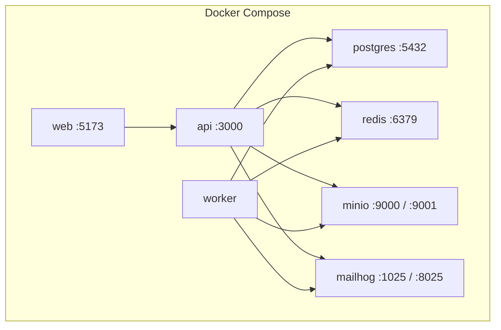

# 04 — High-Level Architecture

This document mirrors the component architecture in the reference PDF `[REF]` and adapts it to the available stack `[BRIEF]` and repository `[REPO]`.

## 1. Context view

```mermaid
flowchart LR
  Admin[Admin / HR / Manager Web\n(existing React app)] --> Edge[Edge\nCDN / WAF / API gateway]
  Employee[Employee / Worker Portal\n(later phase)] --> Edge
  Mobile[Mobile App\n(optional, later)] --> Edge
  Edge --> API[NestJS Modular Monolith\n/api/v1]
  API --> PG[(PostgreSQL 16\nprimary)]
  API --> Redis[(Redis\ncache / queues / rate limits)]
  API --> Obj[(Object Storage\nMinIO dev / S3 prod)]
  API --> Queue[(BullMQ queues)]
  Queue --> Worker[Background Workers]
  Worker --> API
  Worker --> External[Email / SMS / AV scanner\nE-sign / Payroll provider / Accounting]
  API --> IDP[IdP / SSO\nP7]
  API --> Search[(Search Index\noptional)]
  API --> WH[(Analytics Warehouse\noptional)]
```

Clients, edge, application modules, data stores, async processing and external systems are the same five layers described in `[REF]`. The API gateway/BFF remains an edge concern; the NestJS app is the application layer.

## 2. Container view (development)



Web, API and worker are stateless; Postgres, Redis and MinIO use named volumes. Same topology in staging/production with managed services and multiple replicas `[REF]`.

## 3. Application component view

```
apps/api/src/
├── main.ts / worker.ts                 (two entrypoints, one codebase)
├── common/                             (guards, filters, interceptors, decorators, pipes)
├── config/                             (Zod-validated env, typed config)
├── prisma/                             (PrismaService, migrations, seeds)
├── platform/
│   ├── auth/ tenancy/ rbac/ audit/ outbox/ notifications/ approvals/ idempotency/ storage/
└── modules/
    ├── organization/ employees/ contracts/ documents/
    ├── recruiting/ onboarding/ offboarding/
    ├── attendance/ leave/ payroll/ performance/ workforce/ reporting/
```

Each domain module owns its controllers, services, repositories, DTOs, policies and tests. Only declared public interfaces cross module boundaries (doc 05).

## 4. Request lifecycle

```mermaid
sequenceDiagram
  participant C as Client
  participant G as Guards/Interceptors
  participant S as Service
  participant DB as Postgres
  participant O as Outbox Publisher
  participant Q as BullMQ Worker

  C->>G: /api/v1/... + Bearer token
  G->>G: requestId, tenant resolution, JWT verify, permission + scope check
  G->>S: DTO-validated command + RequestContext
  S->>DB: BEGIN; business row + audit_event + outbox row; COMMIT
  S-->>C: 2xx response (redacted DTO)
  O->>DB: SELECT ... FOR UPDATE SKIP LOCKED (pending events)
  O->>Q: enqueue by event id (jobId = event id)
  Q->>S/External: idempotent handler
  Q->>DB: mark outbox published / failed / dead
```

## 5. Data ownership map

| Store          | Owner    | Contents                                                                                        |
| -------------- | -------- | ----------------------------------------------------------------------------------------------- |
| PostgreSQL     | Platform | All relational business data, audit, outbox, tokens, idempotency keys, approvals.               |
| Redis          | Platform | Refresh-token denylist (short), permission cache, rate-limit counters, BullMQ queues/job state. |
| Object storage | Platform | Private employee documents, contract PDFs, import files, payroll exports. Never public URLs.    |
| Search index   | Future   | Projected employee/organization read models; never authoritative.                               |
| Warehouse      | Future   | Analytics read models from published domain events.                                             |

## 6. Deployment view

- Containers (Kubernetes or managed container service) `[REF]`; this plan delivers Docker Compose for local dev and container images for CD.
- Components: web/API, worker, scheduler, Postgres HA, Redis, object storage, message bus `[REF]`. BullMQ on the same Redis satisfies the message-bus role for P0/P1; a dedicated bus can be introduced later without changing domain code.
- Environments: development (Compose), staging, production with migration gates and protected deploys `[REF]`.
- Stateless horizontal scaling; read replicas for reporting `[REF]`.

## 7. Evolution path

| Trigger                                    | Extraction candidate             | Why                                             |
| ------------------------------------------ | -------------------------------- | ----------------------------------------------- |
| Notification volume / provider fan-out     | Notifications                    | Independent scaling, many external calls.       |
| Document scanning CPU/IO                   | Document processing              | Separate worker pool already isolated by queue. |
| Payroll calculation load / lock contention | Payroll engine                   | Configurable adapters, immutable snapshots.     |
| Analytics query load                       | Reporting read model / warehouse | Reporting on OLTP is a named risk `[REF]`.      |

No extraction occurs before evidence justifies it; modular boundaries are extraction-ready from day one `[REF]`.

## 8. Architectural decisions (ADRs to be created during P0.1)

| ID      | Decision                                         | Rationale                                                 |
| ------- | ------------------------------------------------ | --------------------------------------------------------- |
| ADR-001 | Modular monolith, not microservices              | Shared identity/employee core, simple deployment `[REF]`. |
| ADR-002 | Shared DB, shared schema, `tenant_id` + RLS      | Reference decision `[REF]`, confirmed by brief.           |
| ADR-003 | Outbox over fire-and-forget                      | Atomic business/event commit `[REF][BRIEF]`.              |
| ADR-004 | Integer minor units for money                    | Avoid floating point `[REF][BRIEF]`.                      |
| ADR-005 | Two entrypoints (api, worker) in one app package | PDF requires worker process; avoids a second codebase.    |
| ADR-006 | Offset pagination in P1                          | Matches existing frontend `[REPO]`.                       |
