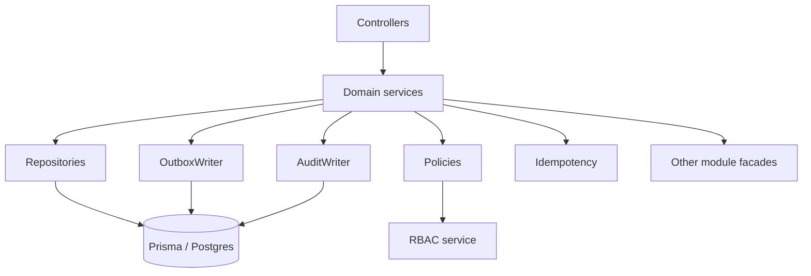

# 05 — Backend Module Architecture

## 1. Module inventory and ownership

"Owns" means: only this module may write the listed tables; other modules interact through its public interface.

| Module                 | Owns                                                                      | Publishes                                                                       | Consumes                                | Phase     |
| ---------------------- | ------------------------------------------------------------------------- | ------------------------------------------------------------------------------- | --------------------------------------- | --------- |
| Tenancy                | `tenants`, tenant settings                                                | `TenantCreated`, `TenantStatusChanged`                                          | —                                       | P0.2      |
| Auth                   | `users`, `refresh_tokens`, `password_reset_tokens`, `mfa_recovery_codes`  | `UserCreated`, `UserLoggedIn`, `UserDisabled`                                   | Tenancy, RBAC                           | P0.2      |
| RBAC                   | `roles`, `permissions`, `role_permissions`, `user_roles`                  | `RoleChanged`, `UserRolesChanged`                                               | Auth, Tenancy                           | P0.3      |
| Audit                  | `audit_events`, `data_access_events`                                      | — (append-only sink)                                                            | all modules via interceptor             | P0.3      |
| Outbox                 | `domain_event_outbox`                                                     | dispatches all events                                                           | all modules via `OutboxWriter`          | P0.4      |
| Approvals              | `approval_requests`, `approval_steps`                                     | `ApprovalRequested`, `ApprovalDecided`                                          | RBAC, Notifications                     | P0.4      |
| Notifications          | `notifications`, `notification_preferences`                               | `NotificationQueued`, `NotificationDelivered`                                   | Auth, Approvals, all domains            | P0.4      |
| Idempotency            | `idempotency_keys`                                                        | —                                                                               | API layer, imports, payroll             | P0.4      |
| Storage                | `employee_documents` metadata, object keys                                | `DocumentUploaded`, `DocumentScanned`                                           | RBAC, Audit                             | P1.4      |
| Organization           | `legal_entities`, `departments`, `locations`, `job_profiles`, `positions` | `OrgStructureChanged`, `ManagerChanged`                                         | Employees                               | P1.1      |
| Employees              | `employees`, `employment_history`                                         | `EmployeeCreated`, `EmployeeUpdated`, `EmployeeStatusChanged`, `ManagerChanged` | Organization, Auth, RBAC, Outbox, Audit | P1.2–P1.3 |
| Contracts              | `employment_contracts`                                                    | `ContractCreated`, `ContractUpdated`                                            | Employees                               | P1.3      |
| Documents              | document service façade over Storage                                      | —                                                                               | Employees, RBAC, Storage                | P1.4      |
| Imports                | `import_jobs`                                                             | `ImportCompleted`, `ImportFailed`                                               | Employees, Storage, Idempotency         | P1.4      |
| Recruiting             | ATS tables                                                                | `OfferAccepted`                                                                 | Employees, Onboarding                   | P4        |
| Onboarding/Offboarding | case/task tables                                                          | `OnboardingCompleted`, `OffboardingCompleted`                                   | Employees, Approvals                    | P4        |
| Attendance             | shift/schedule/timesheet tables                                           | `TimesheetApproved`, `ClockEventRecorded`                                       | Payroll, Workforce                      | P2        |
| Leave                  | policy/accrual/request tables                                             | `LeaveRequested`, `LeaveApproved`                                               | Attendance, Payroll, Approvals          | P2        |
| Payroll                | compensation/payroll tables                                               | `PayrollRunApproved`, `PayrollRunPaid`                                          | Employees, Leave, Attendance            | P3        |
| Performance            | review/goal tables                                                        | `ReviewCompleted`                                                               | Employees, Notifications                | P5        |
| Workforce              | work order/assignment tables                                              | `WorkOrderApproved`                                                             | Payroll, Notifications                  | P6        |
| Reporting              | read models (future)                                                      | —                                                                               | all published events                    | P7        |

Module set and responsibilities are from `[REF]`, with the split into Auth/Tenancy/RBAC and the API-facing services from `[BRIEF]`.

## 2. Standard module anatomy

```
modules/employees/
├── employees.module.ts
├── controllers/employees.controller.ts
├── services/employees.service.ts
├── repositories/employees.repository.ts
├── policies/employees.policy.ts
├── dto/
│   ├── create-employee.dto.ts
│   ├── update-employee.dto.ts
│   ├── change-status.dto.ts
│   ├── list-employees.dto.ts
│   └── employee-response.dto.ts
├── events/employee.events.ts
├── workers/employee-status.worker.ts      (only where needed)
└── tests/
    ├── employees.service.spec.ts
    ├── employees.e2e-spec.ts
    └── employees.policy.spec.ts
```

Rules:

- Controllers validate DTOs, call one service method, map to response DTO. No business logic.
- Services own transactions, state machine checks, history/audit/outbox writes.
- Repositories encapsulate Prisma queries and **always** inject `tenantId` from `RequestContext`, never from user input.
- Policies answer `can(principal, action, resource)` and `visibleFields(principal, resource)`.
- Response DTOs + a redaction interceptor prevent accidental sensitive-field leakage.

## 3. Explicit public interfaces (examples)

```ts
interface EmployeesFacade {
  create(ctx: RequestContext, dto: CreateEmployeeDto): Promise<EmployeeDto>;
  findById(ctx: RequestContext, id: string): Promise<EmployeeDto>;
  list(ctx: RequestContext, query: ListEmployeesQuery): Promise<Paged<EmployeeDto>>;
  update(ctx: RequestContext, id: string, dto: UpdateEmployeeDto): Promise<EmployeeDto>;
  changeStatus(ctx: RequestContext, id: string, dto: ChangeStatusDto): Promise<EmployeeDto>;
  getHistory(ctx: RequestContext, id: string): Promise<EmploymentHistoryDto[]>;
}

interface OrganizationFacade {
  departments: CrudFacade<DepartmentDto>;
  locations: CrudFacade<LocationDto>;
  jobProfiles: CrudFacade<JobProfileDto>;
  positions: CrudFacade<PositionDto>;
  resolveOrgContext(employeeId: string): Promise<OrgContext>;
}

interface DocumentsFacade {
  uploadUrl(ctx: RequestContext, dto: UploadUrlDto): Promise<UploadUrlDto>;
  confirmUpload(ctx: RequestContext, dto: ConfirmUploadDto): Promise<DocumentDto>;
  list(ctx: RequestContext, employeeId: string): Promise<DocumentDto[]>;
  downloadUrl(ctx: RequestContext, id: string): Promise<DownloadUrlDto>;
}
```

Interfaces live in `packages/shared` (types only) so consumers never import another module's internals.

## 4. Dependency rules



- Allowed: module → shared types, module → platform services, module → published facade of another module.
- Forbidden: direct imports of another module's repository/service internals, cross-module Prisma model access, controllers calling repositories, services importing HTTP request objects.
- All cross-module writes happen through the owning module's facade inside a shared transaction (`PrismaService.$transaction` with an injected transaction client).

## 5. Cross-cutting platform services

| Service                 | Responsibility                                                                                                | Used by                       |
| ----------------------- | ------------------------------------------------------------------------------------------------------------- | ----------------------------- |
| `RequestContextService` | Async-local request state: requestId, tenantId, userId, employeeId, roles, permissions, ip, userAgent `[REF]` | every request                 |
| `TenantGuard`           | Resolves and validates tenant from subdomain/header once; attaches to context                                 | every `/api/v1` route         |
| `JwtAuthGuard`          | Verifies access token, loads user status + permission version                                                 | every protected route         |
| `PermissionGuard`       | `@RequirePermissions('employees.read')`                                                                       | controllers                   |
| `PolicyService`         | ABAC scope checks + field visibility                                                                          | services/response serializers |
| `AuditWriter`           | Builds before/after snapshots with redaction                                                                  | services                      |
| `OutboxWriter`          | Writes event rows with `event_id`, aggregate, payload                                                         | services                      |
| `TransactionRunner`     | `$transaction` wrapper injecting tx client into repositories                                                  | services                      |
| `IdempotencyService`    | Key + body hash check/replay                                                                                  | selected POST controllers     |
| `PinoLogger`            | Structured logs with tenant/request IDs and redaction                                                         | global                        |
| `StorageService`        | Presign, verify, delete object; tenant key prefix                                                             | Documents                     |
| `RateLimiter`           | Redis-backed fixed/sliding window                                                                             | auth endpoints                |

## 6. Module interaction example — employee creation

1. `EmployeesController.create()` validates `CreateEmployeeDto`.
2. `EmployeesService.create()` opens a transaction; resolves org references through `OrganizationFacade` in the same tx; generates employee number; inserts `employees`.
3. Writes `employment_history` (event `created`), `audit_events` (before null / after redacted DTO), `domain_event_outbox` (`EmployeeCreated`).
4. Commits; response serializer applies field redaction based on `PolicyService`.
5. Outbox publisher later dispatches `EmployeeCreated`; Onboarding (future) creates a case if the employee entered `onboarding`.

## 7. Testability rules

- Services depend on small interfaces (`Clock`, `OutboxWriter`, `AuditWriter`, `StorageService`) so unit tests use in-memory fakes.
- Integration tests use a real Postgres schema per test worker and a real Redis DB index; no shared mutable fixtures.
- Policy tests are table-driven over role × scope × field.
