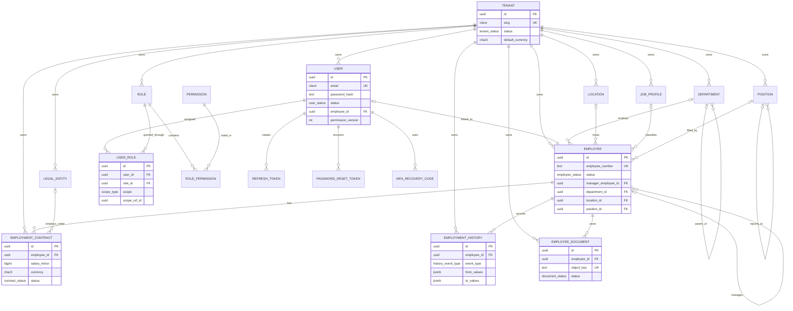
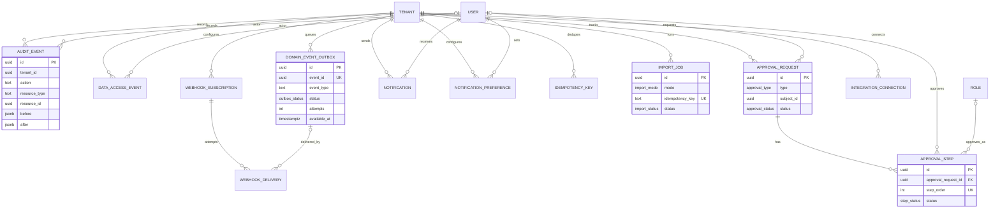
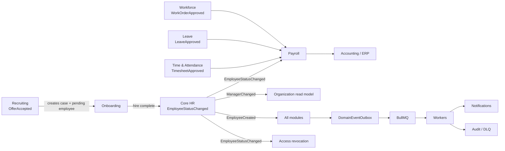

# 07 — Entity Relationship Diagrams

Four Mermaid diagrams: (1) P0/P1 core, (2) platform services, (3) future business domains, (4) cross-domain event flow. Attribute lists show key columns only; the full attribute/nullability inventory is [doc 06](06-database-entity-inventory.md). Cardinality notation: `||--o{` = one-to-many, `|o--o{` = zero/one-to-many, `}o--o{` = many-to-many (resolved by a join table).

## 1. Identity, organization and Core HR

## 2. Platform services

## 3. Future business domains

```mermaid
erDiagram
  EMPLOYEE ||--o{ REQUISITION : hiring_manager
  REQUISITION ||--o{ JOB_POSTING : published_as
  REQUISITION ||--o{ PIPELINE_STAGE : has
  REQUISITION ||--o{ APPLICATION : receives
  CANDIDATE ||--o{ APPLICATION : submits
  APPLICATION ||--o{ INTERVIEW : schedules
  INTERVIEW ||--o{ INTERVIEW_SCORECARD : evaluated_by
  APPLICATION ||--o{ OFFER : results_in

  EMPLOYEE ||--o{ LIFECYCLE_CASE : onboarded_by
  CHECKLIST_TEMPLATE ||--o{ CHECKLIST_TASK_TEMPLATE : contains
  CHECKLIST_TEMPLATE ||--o{ LIFECYCLE_CASE : instantiates
  LIFECYCLE_CASE ||--o{ LIFECYCLE_TASK : contains
  LIFECYCLE_CASE ||--o{ PROVISIONING_REQUEST : requests
  LIFECYCLE_CASE ||--o| EXIT_INTERVIEW : includes
  LIFECYCLE_CASE ||--o{ ASSET_RETURN : tracks
  LIFECYCLE_CASE ||--o{ ACCESS_REVOCATION_REQUEST : requests
  EMPLOYEE ||--o{ PROBATION_REVIEW : reviews

  EMPLOYEE ||--o{ SCHEDULE : assigned
  SHIFT_TEMPLATE ||--o{ SCHEDULE : generates
  EMPLOYEE ||--o{ ATTENDANCE_EVENT : clocks
  EMPLOYEE ||--o{ TIMESHEET : submits
  TIMESHEET ||--o{ TIMESHEET_ENTRY : contains
  EMPLOYEE ||--o{ ATTENDANCE_EXCEPTION : flagged

  EMPLOYEE ||--o{ LEAVE_REQUEST : submits
  LEAVE_TYPE ||--o{ LEAVE_REQUEST : categorizes
  LEAVE_POLICY ||--o{ LEAVE_ACCRUAL_LEDGER : governs
  EMPLOYEE ||--o{ LEAVE_BALANCE : holds
  EMPLOYEE ||--o{ LEAVE_ACCRUAL_LEDGER : accrues
  HOLIDAY_CALENDAR ||--o{ HOLIDAY : contains

  EMPLOYEE ||--o{ COMPENSATION_PLAN : paid_under
  EMPLOYEE ||--o{ COMPENSATION_CHANGE : changed
  PAYROLL_PERIOD ||--o{ PAYROLL_RUN : calculates
  PAYROLL_RUN ||--o{ PAYSLIP : produces
  PAYSLIP ||--o{ PAYSLIP_LINE : breaks_down
  PAYROLL_RUN ||--o{ PAYMENT_EXPORT : exported_as
  PAYMENT_EXPORT ||--o| PAYROLL_RECONCILIATION : reconciled_by
  PAYROLL_PERIOD ||--o{ STATUTORY_REPORT : files

  REVIEW_CYCLE ||--o{ GOAL : contains
  EMPLOYEE ||--o{ GOAL : owns
  GOAL |o--o{ GOAL : parent_of
  REVIEW_CYCLE ||--o{ REVIEW : runs
  REVIEW ||--o{ COMPETENCY_RATING : rates
  REVIEW ||--o| RATING_CALIBRATION : calibrated_by
  EMPLOYEE ||--o{ FEEDBACK : receives
  EMPLOYEE ||--o{ CHECK_IN : attends
  EMPLOYEE ||--o{ PERFORMANCE_IMPROVEMENT_PLAN : subject_of
  EMPLOYEE ||--o{ PROMOTION_REQUEST : promoted_by

  WORKER_PROFILE |o--|| EMPLOYEE : based_on
  WORK_ORDER ||--o{ WORK_ASSIGNMENT : staffed_by
  WORKER_PROFILE ||--o{ WORK_ASSIGNMENT : works
  WORK_ASSIGNMENT ||--o{ COMPLETION_PROOF : proves
  WORK_ASSIGNMENT ||--o{ WORK_ORDER_APPROVAL : approved_by
  WORK_ORDER ||--o{ BILLING_EXPORT : billed_through
  SCHEDULE ||--o{ SHIFT_CLAIM : claimed_through
```

## 4. Cross-domain flow (event-driven boundaries)

All relationships carry `tenant_id`; joint reads must include the same tenant predicate on every joined table, plus RLS as defence-in-depth (doc 09).
