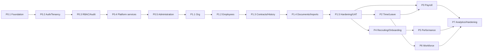

# 19 — Implementation Roadmap

The PDF's phases P0–P7 `[REF]` are preserved; the brief's finer milestones P0.1–P1.5 `[BRIEF]` refine P0/P1. No implementation has started.

## 1. Phase mapping

| PDF phase                    | PDF outcome           | Milestones in this plan                                                                                                |
| ---------------------------- | --------------------- | ---------------------------------------------------------------------------------------------------------------------- |
| P0 Foundation                | Secure platform shell | P0.1 Project foundation → P0.2 Auth & tenancy → P0.3 RBAC & audit → P0.4 Platform services → P0.5 Administration       |
| P1 Core HR                   | HR system of record   | P1.1 Org structure → P1.2 Employee master → P1.3 Contracts & history → P1.4 Documents & imports → P1.5 Hardening & UAT |
| P2 Time & Leave              | Time foundation       | P2 Attendance + Leave                                                                                                  |
| P3 Payroll & Compensation    | Pay lifecycle         | P3                                                                                                                     |
| P4 Recruiting & Onboarding   | Hire-to-productive    | P4                                                                                                                     |
| P5 Performance               | Talent development    | P5                                                                                                                     |
| P6 Workforce/Gig/Work Orders | Flexible workforce    | P6                                                                                                                     |
| P7 Analytics & Hardening     | Enterprise readiness  | P7                                                                                                                     |

## 2. Dependency chain

## 3. P0.1 — Project foundation

**Tasks:** bootstrap npm workspaces root and `@peoplecore/api`/`@peoplecore/shared`; ESLint/Prettier/tsconfig; NestJS API with global pipes/filters/interceptors; Swagger; Pino request logging + correlation IDs; problem-details errors; Compose stack (Postgres, Redis, MinIO, Mailhog, API, worker); Prisma baseline migration + raw SQL extension/trigger/RLS migrations; seed runner; CI pipeline; health endpoints; developer docs. (PDF tickets P0.1-1…P0.1-8 `[REF]`.)

**Dependencies:** none (D-06 placement decision confirmed; D-04 UUID choice confirmed).

**Technical details:** two entrypoints (`main.ts`, `worker.ts`); env schema from doc 17; root scripts from doc 16; `api` listens on 3000 `[REPO]`; OpenAPI at `/api/docs`.

**Acceptance criteria:** `docker compose up --build` healthy; `npm install`, `npm run lint`, `npm run typecheck`, `npm test`, `npm run build` green; `prisma migrate dev` + seed succeed; `/health/live` 200, `/health/ready` 200; Swagger renders; new dev boots in <15 min `[REF]`.

**Tests:** health e2e, error-format test, logging redaction test, migration-from-scratch test, CI smoke.

**Deliverables:** workspace skeleton, Compose stack, baseline migration, CI workflows, contributor docs, ADRs 001–006.

## 4. P0.2 — Authentication and tenancy

**Tasks:** tenant model/guard and subdomain/header resolution; users; Argon2id; login/refresh/rotate/reuse detection/family revocation; logout; password reset without enumeration; MFA data model; rate limiting; cookie + CSRF; `/me`; RequestContext; database RLS session wiring; permission cache foundation.

**Dependencies:** P0.1.

**Technical details:** token claims from doc 10; `refresh_tokens`/`password_reset_tokens` models; audit events for all auth actions; Redis counters.

**Acceptance criteria:** login/refresh/logout/reset flows work end-to-end; reuse revokes family; 5-failure lockout; cross-tenant login impossible; `tenantId` in body rejected 422; RLS denies wrong tenant; cookie flags verified.

**Tests:** C-01, C-02, C-11, C-12, C-13, cookie/rate-limit suites.

**Deliverables:** Auth, Tenancy modules; auth e2e suite; security review notes.

## 5. P0.3 — RBAC and audit

**Tasks:** permissions catalogue; six seed roles; RolePermission/UserRole with scopes; `@RequirePermissions` guard; `PolicyService` for Self/Direct reports/Department/Location/Tenant; field-level redaction interceptor; `AuditEvent`/`DataAccessEvent` append-only writer; DB role grants and immutability triggers; audit read endpoints.

**Dependencies:** P0.2.

**Technical details:** matrix from doc 11; audit snapshots scrubbed; Redis permission cache keyed by `permission_version`.

**Acceptance criteria:** every endpoint has explicit permission metadata; role/scope tests pass; audit rows immutable at DB level; mutations produce redacted audit entries; auditor can read audit but not PII.

**Tests:** C-03, C-04, C-05, C-07, C-20; full role × scope × field table.

**Deliverables:** RBAC and Audit modules, seed roles/permissions, policy test matrix.

## 6. P0.4 — Platform services

**Tasks:** `DomainEventOutbox` + publisher with `SKIP LOCKED`; BullMQ queues and worker bootstrap; retry/backoff/DLQ + replay tooling; approval engine; notifications + preferences + email worker; idempotency store/interceptor; storage service for presigning; metrics/tracing wiring.

**Dependencies:** P0.3.

**Technical details:** doc 14; queue table; `IdempotencyKey` scope per endpoint; Prometheus endpoint on internal port.

**Acceptance criteria:** mutation + audit + outbox commit atomically; published events dispatch with `jobId = eventId`; duplicate delivery has no duplicate effect; failed jobs land in DLQ after 5 attempts; outbox lag metric visible; notification delivered to Mailhog.

**Tests:** C-08, C-09, C-10; outbox atomicity, duplicate job, DLQ tests.

**Deliverables:** platform modules, worker container, replay CLI, dashboards.

## 7. P0.5 — Administration

**Tasks:** users/roles/permissions API; audit viewer; notification inbox; basic tenant settings; integration with frontend users/roles and audit screens.

**Dependencies:** P0.3, P0.4.

**Technical details:** `/users`, `/roles`, `/permissions`, `/audit-events`, `/notifications` from doc 12; tenant-admin-only grants.

**Acceptance criteria:** admin can invite user, assign scoped role, revoke permission (effective next request), view audit; no default production password; all admin mutations audited.

**Tests:** admin CRUD e2e, escalation tests, audit immutability re-check.

**Deliverables:** admin API complete; frontend integration notes (no frontend edits yet).

## 8. P1.1 — Organization management

**Tasks:** legal entity, departments (hierarchy + cycle prevention + closure table), locations, job profiles, positions; tenant-scoped unique codes; no hard delete; `OrgStructureChanged` event.

**Dependencies:** P0.5.

**Acceptance criteria:** CRUD + filters work; cycles rejected 409; duplicate codes per tenant rejected but allowed cross-tenant; audit/outbox written; org chart query returns subtree.

**Tests:** C-18, C-19; org CRUD e2e; closure consistency test.

**Deliverables:** Organization module + facade.

## 9. P1.2 — Employee management

**Tasks:** employees table, employee number generation, service methods (create/findById/list/update/changeStatus/getHistory), response redaction, search/filter/sort/pagination, manager-scope queries, optimistic locking, lifecycle state machine (doc 13), direct-reports endpoint.

**Dependencies:** P1.1, P0.3, P0.4.

**Acceptance criteria:** all 7×7 transitions behave exactly as matrix; invalid → 409 with no writes; redaction correct for six roles; manager sees only reports; list performance target met; frontend status mapping task identified.

**Tests:** C-04, C-05, C-06, C-17; 49 transition pairs; list filter/concurrency/performance tests.

**Deliverables:** Employees module, lifecycle documentation, API contract.

## 10. P1.3 — Contracts and employment history

**Tasks:** contracts CRUD with minor-unit salary; contract status; history rows for status/org/contract changes; termination side effects; immutable history endpoints.

**Dependencies:** P1.2.

**Acceptance criteria:** salary never float; contract create/update writes history + audit + outbox; history immutable; termination sets date and emits event; salary redacted without `employees.view_salary`.

**Tests:** contract e2e, money-type test, history immutability test, termination side-effect test.

**Deliverables:** Contracts module, history writer.

## 11. P1.4 — Documents and imports

**Tasks:** storage presign flow, upload validation, confirm with object existence check + checksum, scan status, download presign, CSV import worker with validate-first/per-row results/modes/idempotency/5MB-1000 row cap.

**Dependencies:** P1.2, P0.4.

**Acceptance criteria:** private bucket only; presigned URLs expire; upload validation enforced server-side; confirm fails if object missing; scan status gates download; import idempotent with row results; all actions audited.

**Tests:** C-14, C-15, C-16, C-22; file lifecycle and malicious CSV tests.

**Deliverables:** Documents facade, Imports module, AV integration interface.

## 12. P1.5 — Testing and hardening

**Tasks:** full security test suite from T-01…T-24; Playwright E2E; load test; coverage gates; secret scanning; dependency audit; restore drill; UAT with frontend screens; bug fixes; production readiness review.

**Dependencies:** P1.1–P1.4.

**Acceptance criteria:** all critical scenario gates pass; coverage gates met; p95 targets met; no high/critical vulnerabilities; UAT signoff `[REF]`; restore runbook rehearsed.

**Risk acceptance (2026-11-23):** `npm audit --omit=dev` still reports 11 high and 5 moderate findings that require NestJS 12.x and Prisma 7.x major upgrades. This is accepted for P1.5 with a dedicated major-upgrade work item before production release; reassess at the production readiness review.

**Tests:** entire doc 18 suite plus Playwright/k6 reports.

**Deliverables:** QA report, security review, UAT signoff, tuned dashboards.

## 13. P2 — Time and Leave

**Tasks:** shift templates, schedules, attendance events (idempotent clock-in/out), timesheets/entries, overtime rules, exceptions; leave types/policies, accrual ledger, balances, requests, holidays, blackout periods; approval integration.

**Dependencies:** P1.5.

**Acceptance criteria:** clock events idempotent; accrual ledger immutable; approvals route by scope; balances reconcile with ledger; blackout/conflict checks; events published to outbox.

**Tests:** clock idempotency, accrual calculation, approval routing, policy rule tests.

**Deliverables:** Attendance and Leave modules + data model activated.

## 14. P3 — Payroll and Compensation

**Tasks:** compensation plans/changes, pay components, tax rule sets/adapters (one jurisdiction first), payroll periods with locking, payroll runs with immutable snapshots, payslips, adjustments, payment exports, reconciliation, maker-checker.

**Dependencies:** P1.5, P2 (approved time/leave inputs).

**Acceptance criteria:** all money integer minor units; no floating point; immutable payslips; dual approval; locked periods reject changes; exports idempotent; reconciliation report; no hardcoded tax logic.

**Tests:** payroll calculation fixtures, maker-checker, idempotent export, immutability tests.

**Deliverables:** Payroll module, jurisdiction adapter interface, controls documentation.

## 15. P4 — Recruiting and Onboarding

**Tasks:** requisitions, postings, candidates, applications, stages, interviews, scorecards, offers; onboarding/offboarding templates, cases, tasks, provisioning, probation, exit interviews, asset returns, access revocation; `OfferAccepted` → pending employee + onboarding case; `EmployeeStatusChanged` → offboarding case.

**Dependencies:** P1.5 (Core HR), P0.4 (approvals/notifications).

**Acceptance criteria:** offer acceptance creates case + pending employee atomically via outbox; termination triggers offboarding; checklist completion evidence stored privately; all events auditable.

**Tests:** hire-to-onboarding E2E, termination-to-offboarding E2E, duplicate event tests.

**Deliverables:** Recruiting and Onboarding/Offboarding modules.

## 16. P5 — Performance Management

**Tasks:** cycles, goals, check-ins, reviews, feedback, calibration, competencies, PIPs, promotions.

**Dependencies:** P4 (org maturity), P1.5.

**Acceptance criteria:** strict visibility (employee/manager/HR/calibrated reviewer); feedback immutable after submission; calibration maker-checker; sensitive fields encrypted and redacted.

**Tests:** visibility matrix, calibration control, encryption-at-rest assertions.

**Deliverables:** Performance module.

## 17. P6 — Workforce / Gig / Work Orders

**Tasks:** worker profiles, rate cards, work orders, assignments, shift claims, completion proof, approvals, billing exports.

**Dependencies:** P2 (time data), P3 (payroll interface).

**Acceptance criteria:** work order identity uses Core HR; approved time/amount flows to payroll/billing exactly once; exports idempotent; completion proof private.

**Tests:** assignment lifecycle, duplicate approval, billing idempotency.

**Deliverables:** Workforce module.

## 18. P7 — Analytics and Enterprise Hardening

**Tasks:** read models/warehouse projection from events, reporting API, SSO/SCIM, DSAR export/delete automation, advanced compliance/retention, read replicas, cost/performance tuning.

**Dependencies:** P2–P6.

**Acceptance criteria:** reports never query OLTP hot path directly; SSO/SCIM works with tenant provisioning; DSAR workflows audited; legal hold honoured; enterprise security review passed.

**Tests:** projection consistency, SSO/SCIM e2e, DSAR audit, read-replica routing.

**Deliverables:** Reporting module, enterprise hardening report.

## 19. Cross-cutting exit criteria for every milestone

1. All listed tests green in CI.
2. API contract/OpenAPI updated and diffed.
3. Architecture docs updated in the same PR.
4. No new sensitive data in logs/docs/seeds.
5. Migrations reviewed and forward-compatible.
